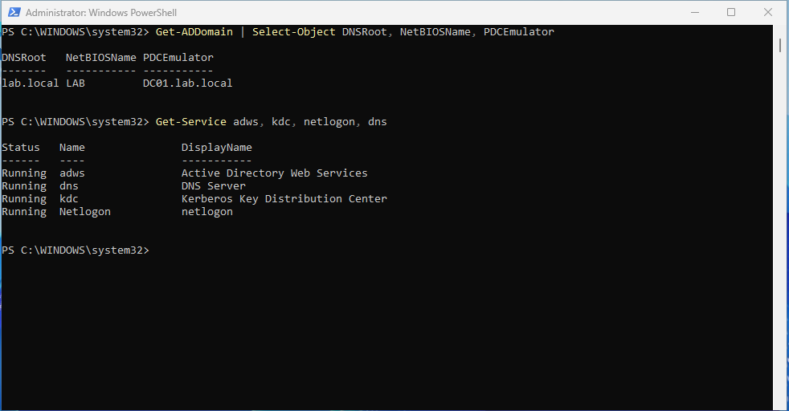
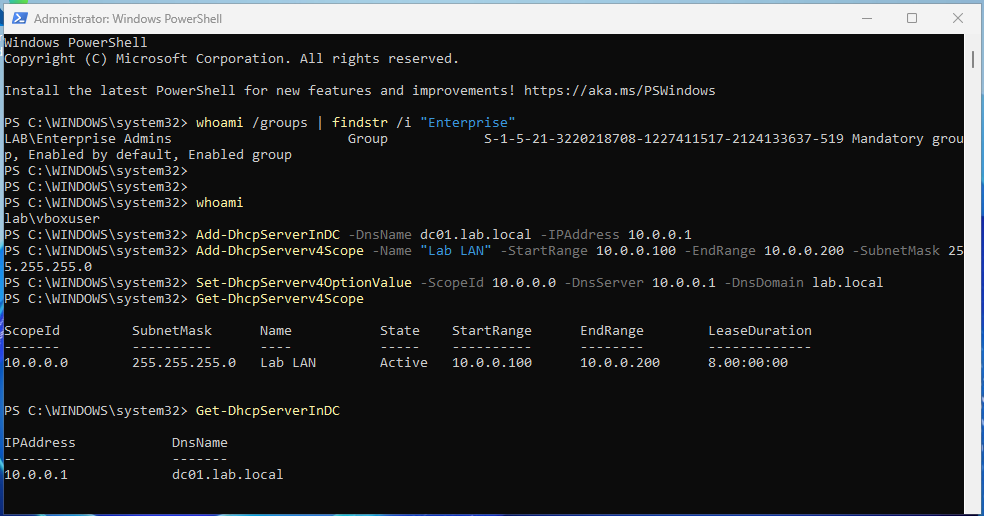

# Windows Server 2025 Active Directory Lab

A small company domain built from scratch in VirtualBox: a domain controller with AD DS, DNS and DHCP, a domain-joined Windows client, department OUs and users created with PowerShell, Group Policies, a permission-controlled file share, and real troubleshooting tickets.

**Skills shown:** Windows Server 2025 · Active Directory · DNS · DHCP · Group Policy · NTFS/share permissions · PowerShell automation · troubleshooting and documentation

---

## Lab diagram

```
                 Internet
                    |
             [VirtualBox NAT]
                    |
   +----------------+----------------+
   |  DC01  (Windows Server 2025)    |
   |  AD DS · DNS · DHCP · File share|
   |  192.168.10.10  /  dre.lab      |
   +----------------+----------------+
                    |
         Internal network "labnet"
            192.168.10.0/24
                    |
   +----------------+----------------+
   |  CLIENT01 (Windows 11 Pro/Ent)  |
   |  DHCP 192.168.10.100-200        |
   +---------------------------------+
```

| Item | Value |
|---|---|
| Domain | `dre.lab` (NetBIOS `DRE`) |
| Domain controller | `DC01` – 192.168.10.10 – 2 vCPU, 4 GB RAM, 60 GB |
| Client | `CLIENT01` – Windows 11 Pro or Enterprise evaluation, 4 GB RAM |
| OUs | IT, HR, Finance, Operations |
| Groups | IT-Staff, HR-Staff, Finance-Staff, Ops-Staff |

---

## What I built

### 1. Domain controller

VM network: Adapter 1 = NAT (internet), Adapter 2 = Internal Network `labnet`.

```powershell
Rename-Computer -NewName DC01 -Restart

Get-NetAdapter      # find the internal adapter, usually "Ethernet 2"
New-NetIPAddress -InterfaceAlias "Ethernet 2" -IPAddress 192.168.10.10 -PrefixLength 24
Set-DnsClientServerAddress -InterfaceAlias "Ethernet 2" -ServerAddresses 127.0.0.1

Install-WindowsFeature AD-Domain-Services -IncludeManagementTools
Install-ADDSForest -DomainName "dre.lab" -DomainNetbiosName "DRE" -InstallDns
```

Check after the restart (log in as `DRE\Administrator`):

```powershell
Get-ADDomain
Get-Service adws, kdc, netlogon, dns
```



### 2. DHCP for the lab network

```powershell
Install-WindowsFeature DHCP -IncludeManagementTools
Add-DhcpServerInDC -DnsName dc01.dre.lab -IPAddress 192.168.10.10
Add-DhcpServerv4Scope -Name "Lab LAN" -StartRange 192.168.10.100 -EndRange 192.168.10.200 -SubnetMask 255.255.255.0
Set-DhcpServerv4OptionValue -ScopeId 192.168.10.0 -DnsServer 192.168.10.10 -DnsDomain dre.lab
Get-DhcpServerv4Scope
```



### 3. Join a Windows client to the domain

Client VM: one adapter on Internal Network `labnet`. Use Windows 11 **Pro or Enterprise** (Home can't join a domain).

```powershell
ipconfig /all                     # should show 192.168.10.1xx and DNS 192.168.10.10
nslookup dre.lab                  # must answer from 192.168.10.10
Rename-Computer -NewName CLIENT01 -Restart
Add-Computer -DomainName dre.lab -Credential DRE\Administrator -Restart
```


### 4. OUs, users and groups with PowerShell

[`scripts/New-BulkADUsers.ps1`](scripts/New-BulkADUsers.ps1) reads [`scripts/users.csv`](scripts/users.csv), creates each department OU and group if missing, creates the user (must change password at first logon) and writes a CSV report. It supports `-WhatIf` and is safe to run twice.

```powershell
Set-ExecutionPolicy -Scope Process Bypass
.\New-BulkADUsers.ps1 -CsvPath .\users.csv -WhatIf    # dry run
.\New-BulkADUsers.ps1 -CsvPath .\users.csv            # real run
.\New-BulkADUsers.ps1 -CsvPath .\users.csv            # second run: every user "Skipped"
```


### 5. Password and lockout policy

```powershell
Set-ADDefaultDomainPasswordPolicy -Identity dre.lab -MinPasswordLength 12 -ComplexityEnabled $true `
  -LockoutThreshold 5 -LockoutDuration 00:15:00 -LockoutObservationWindow 00:15:00
Get-ADDefaultDomainPasswordPolicy
```


### 6. Finance file share with NTFS permissions

Only Finance-Staff (and admins) can open the Finance folder.

```powershell
New-Item -Path C:\Shares\Finance -ItemType Directory
New-SmbShare -Name Finance -Path C:\Shares\Finance -FullAccess "DRE\Domain Admins" -ChangeAccess "DRE\Finance-Staff"
icacls C:\Shares\Finance /inheritance:r /grant "DRE\Domain Admins:(OI)(CI)F" "DRE\Finance-Staff:(OI)(CI)M" "SYSTEM:(OI)(CI)F"
```

### 7. Group Policies

```powershell
New-GPO -Name "Finance - Map S drive" | New-GPLink -Target "OU=Finance,DC=dre,DC=lab"
New-GPO -Name "HR - Block USB storage" | New-GPLink -Target "OU=HR,DC=dre,DC=lab"
```

Settings (in Group Policy Management, right-click the GPO > Edit):

| GPO | Setting |
|---|---|
| Finance - Map S drive | User Configuration > Preferences > Windows Settings > Drive Maps > New: `\\DC01\Finance`, letter **S:**, Reconnect |
| HR - Block USB storage | User Configuration > Policies > Administrative Templates > System > Removable Storage Access > **All Removable Storage classes: Deny all access** = Enabled |

Test on CLIENT01, logged in as a Finance user and then an HR user:

```powershell
gpupdate /force
gpresult /r
```


### 8. Health check report

[`scripts/Get-HealthCheck.ps1`](scripts/Get-HealthCheck.ps1) reports uptime, CPU, memory, disk space, stopped automatic services and recent system errors as HTML.


---

## Troubleshooting tickets

Real faults I caused on purpose and then fixed, written up like help-desk tickets:

| # | Ticket | Root cause |
|---|---|---|
| 1 | [User locked out](tickets/01-account-lockout.md) | 5 wrong passwords triggered the lockout policy |
| 2 | [Client can't join the domain](tickets/02-domain-join-dns.md) | Client DNS pointed to 8.8.8.8, not the DC |
| 3 | [S: drive not showing](tickets/03-drive-map-gpo.md) | User in the wrong OU, so the GPO didn't apply |

---

## What I learned

- Most domain join and logon problems are DNS problems. Clients must use the DC as their DNS server.
- Run destructive scripts with `-WhatIf` first, and make them safe to run twice.
- `gpresult /r` is the first command for any "policy isn't working" ticket.
- Share permissions and NTFS permissions both apply. The most restrictive one wins.

---

*Lab built by [Al-Dren Daimon](https://www.linkedin.com/in/daimonaldren) – CompTIA Security+ · BSc Computer Science*
